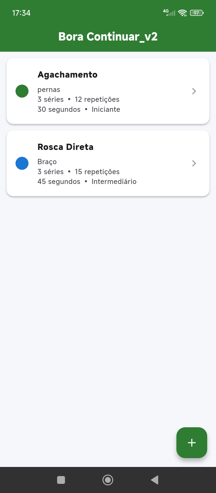
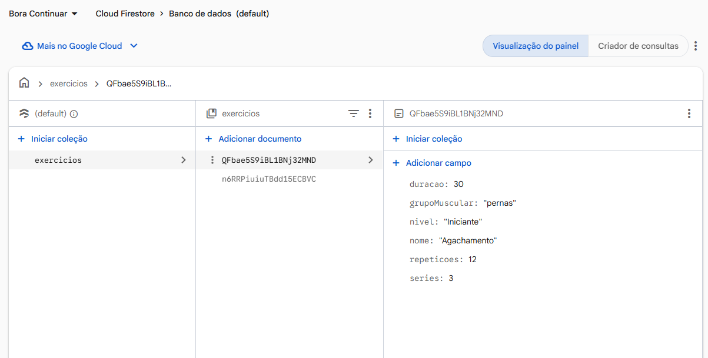

# Demonstração do App

### Aplicativo em funcionamento

### Dados no Firebase Cloud Firestore

# Bora Continuar 

Aplicativo mobile desenvolvido em Flutter para cadastro e gerenciamento de exercícios físicos, 
com armazenamento de dados na nuvem utilizando Firebase Cloud Firestore.

## Sobre o projeto

Projeto acadêmico desenvolvido para a Avaliação 2, com o objetivo de adaptar o aplicativo da Avaliação 1 
para armazenar os dados na nuvem, utilizando o Cloud Firestore.

## Funcionalidades

- Cadastro de exercícios físicos
- Listagem dos exercícios cadastrados
- Visualização dos detalhes de cada exercício
- Exclusão de exercícios
- Armazenamento e recuperação dos dados na nuvem

## Tecnologias utilizadas

- **Flutter** — desenvolvimento do aplicativo mobile
- **Dart** — linguagem de programação
- **Firebase Core** — integração com o Firebase
- **Cloud Firestore** — banco de dados NoSQL na nuvem
- **Android Studio** — ambiente de desenvolvimento

## Banco de dados

Os exercícios são armazenados na coleção `exercicios` do Cloud Firestore.

Cada documento contém os seguintes campos:

- `nome`
- `grupoMuscular`
- `series`
- `repeticoes`
- `duracao`
- `nivel`

## Testes realizados

- Inicialização do Firebase
- Cadastro de exercícios pelo aplicativo
- Consulta dos exercícios cadastrados
- Visualização dos detalhes
- Exclusão de exercícios
- Verificação da persistência dos dados após fechar e abrir o aplicativo

## Objetivo acadêmico

Praticar o desenvolvimento de aplicativos mobile com Flutter e a utilização do Firebase Cloud Firestore
para armazenar dados na nuvem.

---

**Projeto acadêmico — Avaliação 2**

Desenvolvido por Vania Godoy.
